# BATTLEFIELD LAYOUT REFERENCE

This is a visual reference for every Battlefield Layout card used across Matched Play and Campaign Mode missions. Missions and layout-selection rules call these out by name (for example, "Layout: C9 — Stronghold Breach"); this page shows what each one looks like. It is a reference, not its own ruleset — see the Missions chapter for how Battlefield Layouts are chosen and used, and the Campaign Missions chapter for how Campaign-specific layouts are assigned.

Each card shows the board, the two Deployment Zones (blue and red), and the printed objective markers. Treat the exact pixel dimensions as illustrative; translate proportions to your table and terrain at normal scale.

## Matched Play Layouts (M)

The standard deployment layouts for ordinary matched-play games. Use these as the default pool when no specific Mission calls for something else.

### M1 — Open Front

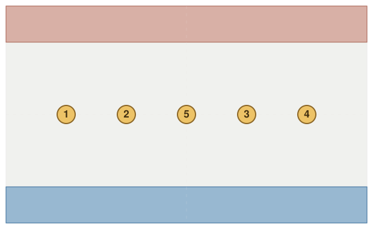

Blue deployment: a single band along the bottom edge. Red deployment: a single band along the top edge. Objectives: 5.

### M2 — Staggered Front

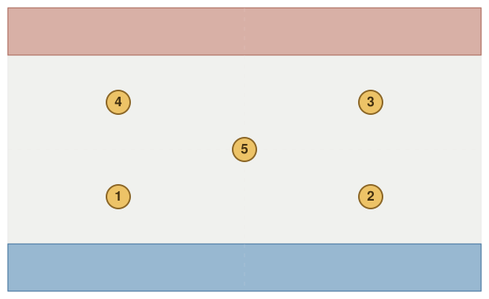

Blue deployment: a single band along the bottom edge. Red deployment: a single band along the top edge. Objectives: 5.

### M2 — Staggered Front (Variant)

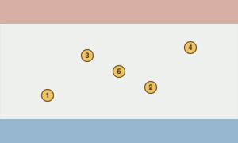

Blue deployment: a single band along the bottom edge. Red deployment: a single band along the top edge. Objectives: 5.

### M3 — Crossroads

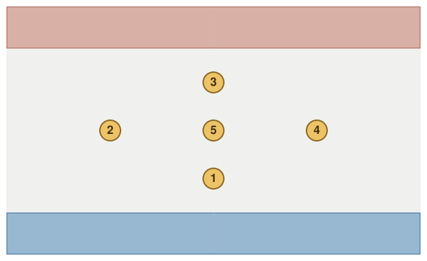

Blue deployment: a single band along the bottom edge. Red deployment: a single band along the top edge. Objectives: 5.

### M4 — Opposing Corners

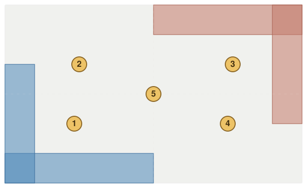

Blue deployment: an L-shaped zone wrapping the bottom-left corner. Red deployment: an L-shaped zone wrapping the top-right corner. Objectives: 5.

### M5 — Split Wings

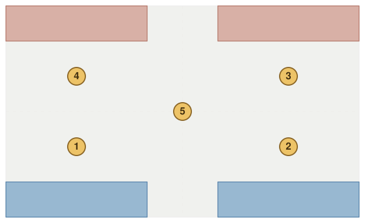

Blue deployment: two separate zones along the bottom edge. Red deployment: two separate zones along the top edge. Objectives: 5.

### M6 — Crossed Wings

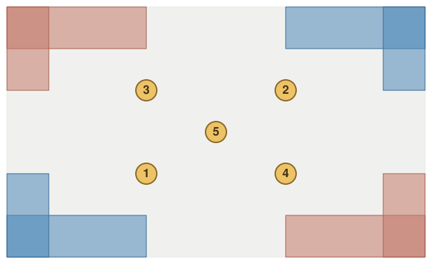

Blue deployment: 4 small pockets ringing the whole perimeter. Red deployment: 4 small pockets ringing the whole perimeter. Objectives: 5.

### M7 — Diagonal Front

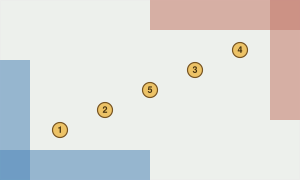

Blue deployment: an L-shaped zone wrapping the bottom-left corner. Red deployment: an L-shaped zone wrapping the top-right corner. Objectives: 5.

### M8 — Divided Theater

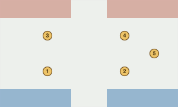

Blue deployment: two separate zones along the bottom edge. Red deployment: two separate zones along the top edge. Objectives: 5.

### M9 — Crossed Wings

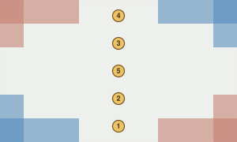

Blue deployment: 4 small pockets ringing the whole perimeter. Red deployment: 4 small pockets ringing the whole perimeter. Objectives: 5.

## Additional Layouts (A)

Extra layouts for matched play and generic battles, offering more variety than the core Matched Play set.

### A1 — Parallel Advance

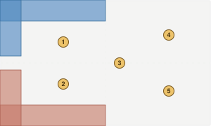

Blue deployment: an L-shaped zone wrapping the top-left corner. Red deployment: an L-shaped zone wrapping the bottom-left corner. Objectives: 5.

### A2 — Twin Bastion

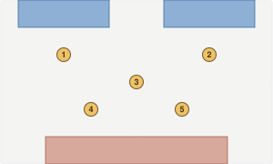

Blue deployment: two separate zones along the top edge. Red deployment: one compact zone at the bottom edge. Objectives: 5.

### A3 — Scattered Patrol

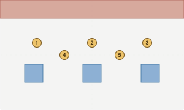

Blue deployment: 3 small pockets scattered through the interior. Red deployment: a single band along the top edge. Objectives: 5.

### A4 — Converging Escape

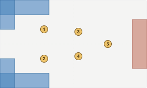

Blue deployment: 4 small pockets ringing the whole perimeter. Red deployment: one compact zone at the right edge. Objectives: 5.

### A5 — Advance Guard

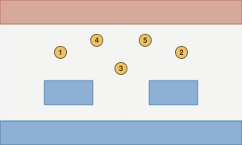

Blue deployment: 3 small pockets ringing the whole perimeter. Red deployment: a single band along the top edge. Objectives: 5.

### A6 — Three-Way Junction

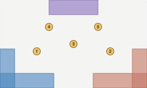

Blue deployment: 3 small pockets ringing the whole perimeter. Red deployment: an L-shaped zone wrapping the bottom-right corner. Objectives: 5.

### A7 — Vanguard Clash

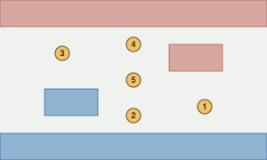

Blue deployment: two separate zones along the bottom edge. Red deployment: two separate zones along the top edge. Objectives: 5.

### A8 — Twin Gates

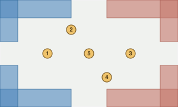

Blue deployment: 4 small pockets ringing the whole perimeter. Red deployment: 4 small pockets ringing the whole perimeter. Objectives: 5.

## Campaign Layouts (C)

Layouts built for Campaign Mode missions, referenced directly by name from the Campaign Missions chapter.

### C1 — Encirclement

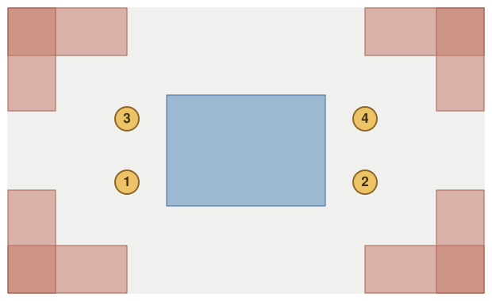

Blue deployment: one compact zone set back from the edges, in the open interior. Red deployment: 8 small pockets ringing the whole perimeter. Objectives: 4.

### C2 — Gauntlet

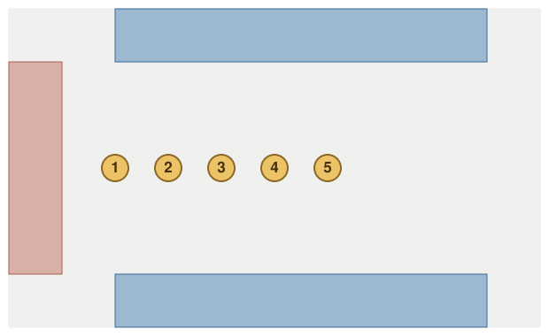

Blue deployment: two separate zones along the top edge. Red deployment: one compact zone at the left edge. Objectives: 5.

### C3 — Diagonal Pursuit

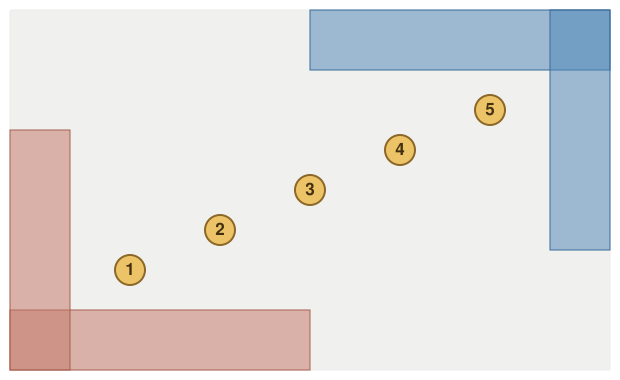

Blue deployment: an L-shaped zone wrapping the top-right corner. Red deployment: an L-shaped zone wrapping the bottom-left corner. Objectives: 5.

### C4 — Pincer

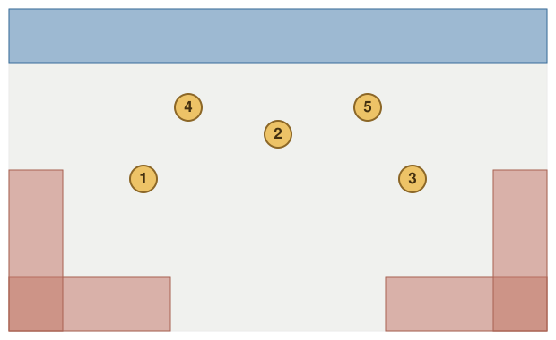

Blue deployment: a single band along the top edge. Red deployment: 4 small pockets ringing the whole perimeter. Objectives: 5.

### C5 — Stronghold

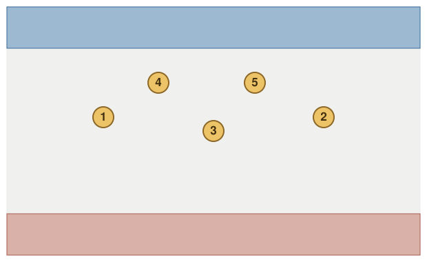

Blue deployment: a single band along the top edge. Red deployment: a single band along the bottom edge. Objectives: 5.

### C6 — River

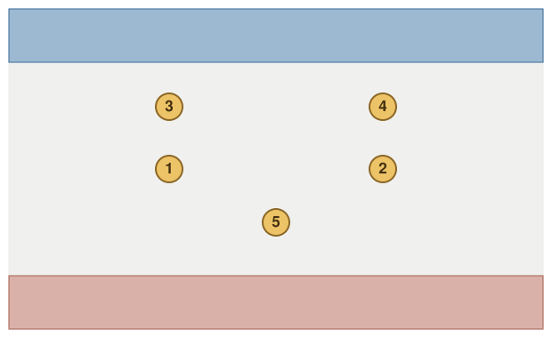

Blue deployment: a single band along the top edge. Red deployment: a single band along the bottom edge. Objectives: 5.

### C7 — Scattered

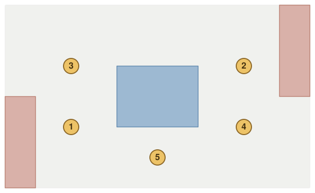

Blue deployment: one compact zone set back from the edges, in the open interior. Red deployment: two separate zones along the top edge. Objectives: 5.

### C8 — Forked Escape

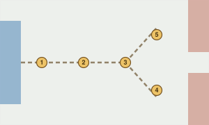

Blue deployment: one compact zone at the left edge. Red deployment: two separate zones along the top edge. Objectives: 5.

### C9 — Stronghold Breach

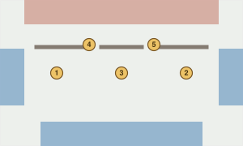

Blue deployment: 3 small pockets ringing the whole perimeter. Red deployment: one compact zone at the top edge. Objectives: 5.

### C10 — Crossfire

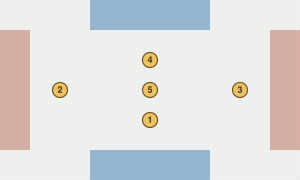

Blue deployment: two separate zones along the top edge. Red deployment: two separate zones along the left edge. Objectives: 5.

## Escort Layouts (E)

Layouts for Escort, pursuit, and journey-style missions, where one side is moving a target across the board.

### E1 — Switchback Trail

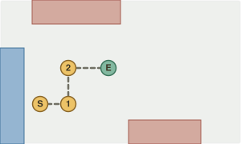

Blue deployment: one compact zone at the bottom-left corner. Red deployment: two separate zones along the top edge. Objectives: 4.

### E2 — Running Battle

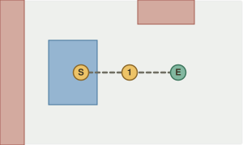

Blue deployment: one compact zone set back from the edges, in the open interior. Red deployment: two separate zones along the top edge. Objectives: 3.

### E3 — Split Evacuation

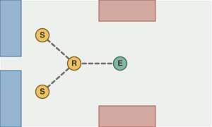

Blue deployment: two separate zones along the top edge. Red deployment: two separate zones along the top edge. Objectives: 4.

## Rescue Layouts (R)

Layouts for rescue, heist, and recovery-style missions, usually built around one or more interior strongpoints.

### R1 — Inner Vault

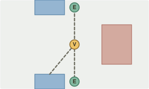

Blue deployment: two separate zones along the top edge. Red deployment: one compact zone set back from the edges, in the open interior. Objectives: 3.

### R2 — False Reliquaries

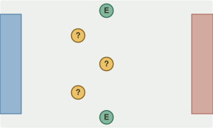

Blue deployment: one compact zone at the left edge. Red deployment: one compact zone at the right edge. Objectives: 5.

### R3 — Sinking Ruins

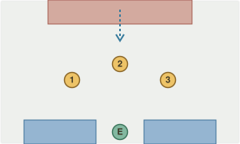

Blue deployment: two separate zones along the bottom edge. Red deployment: one compact zone at the top edge. Objectives: 4.

